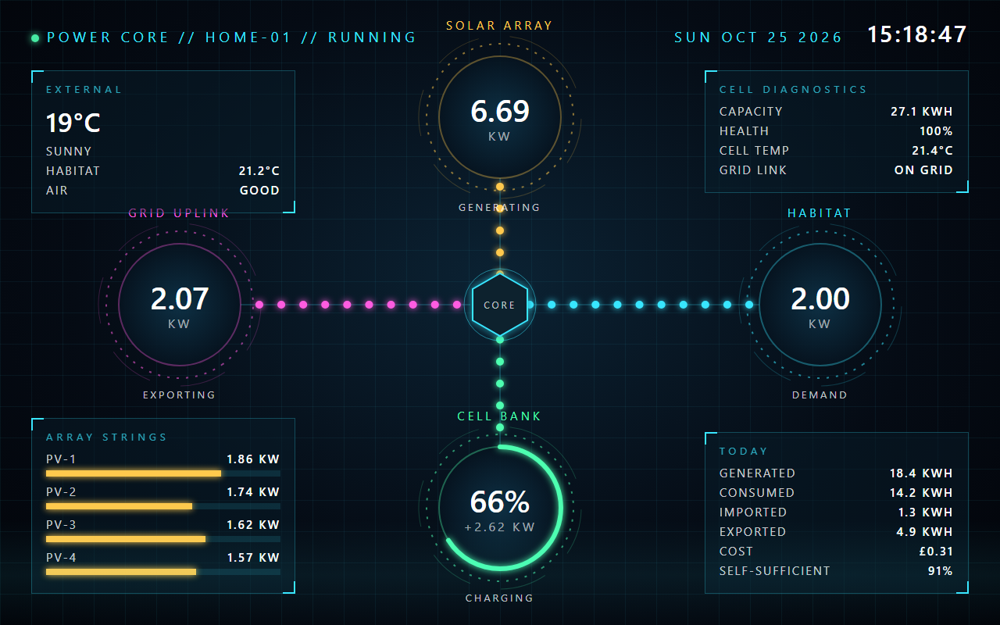
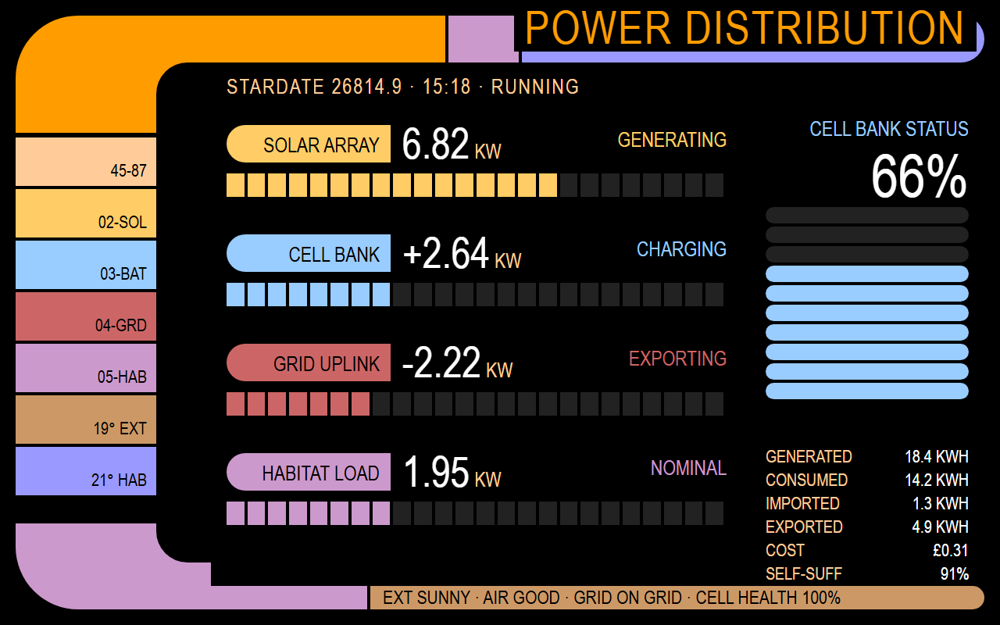
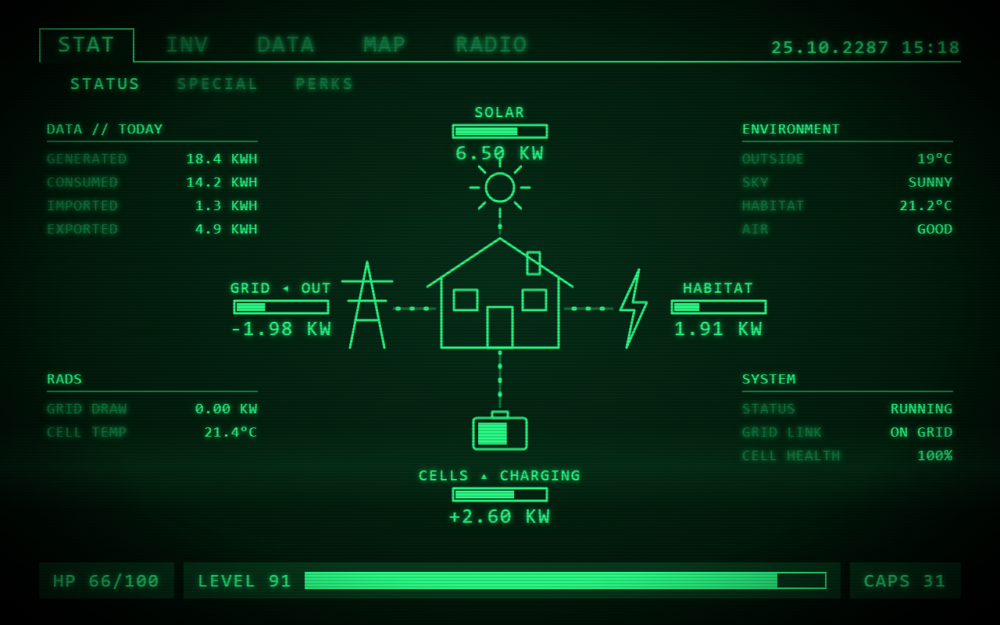
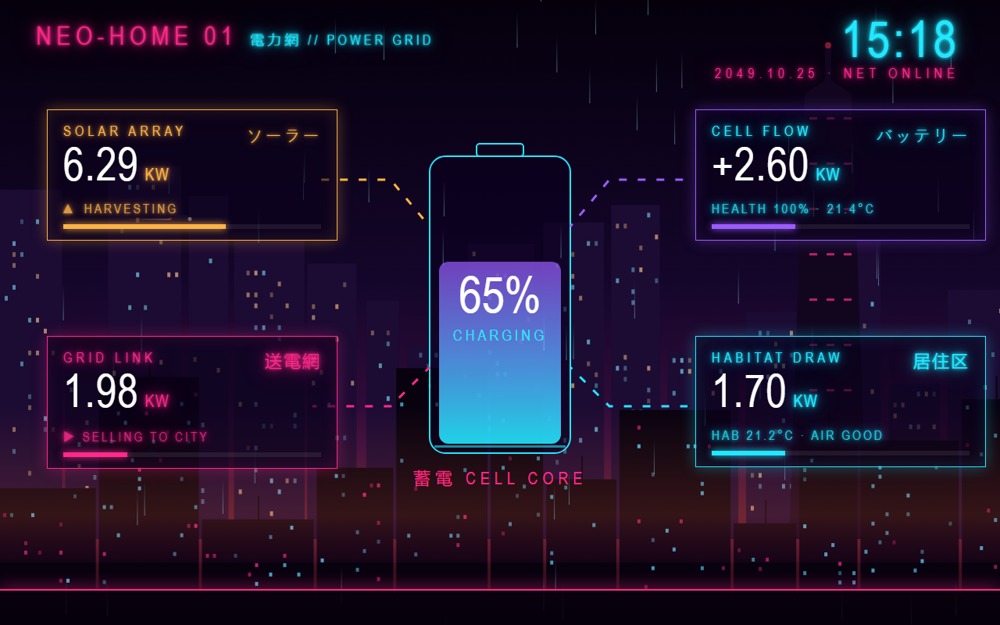
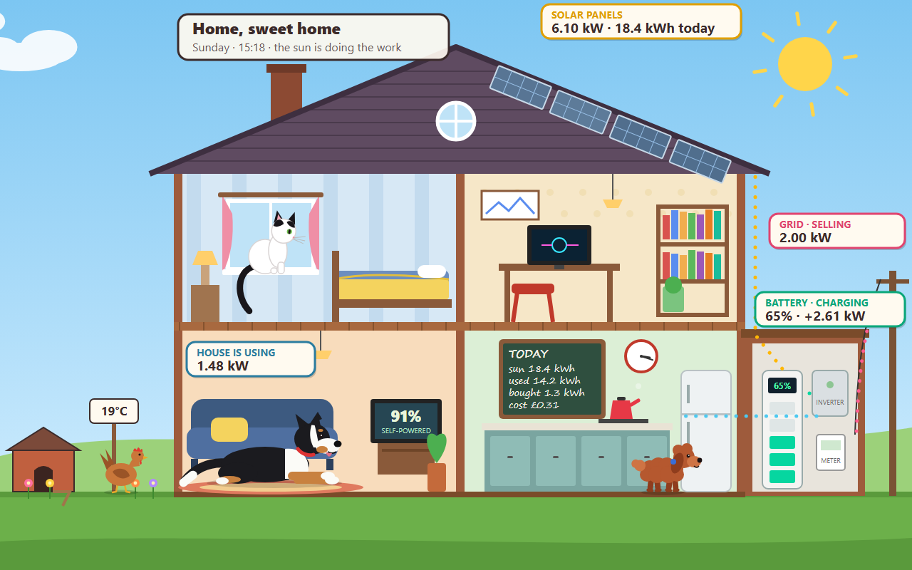
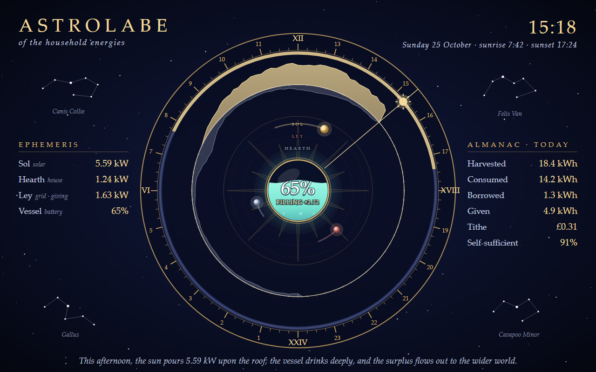
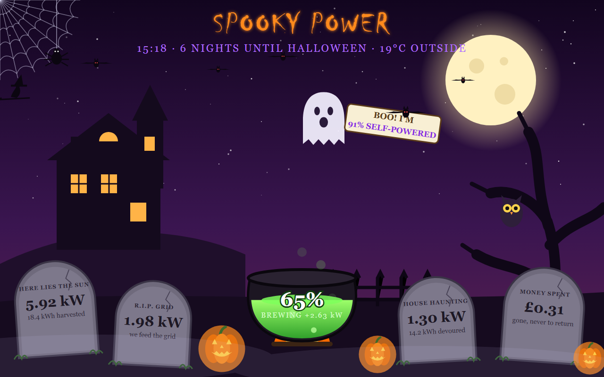
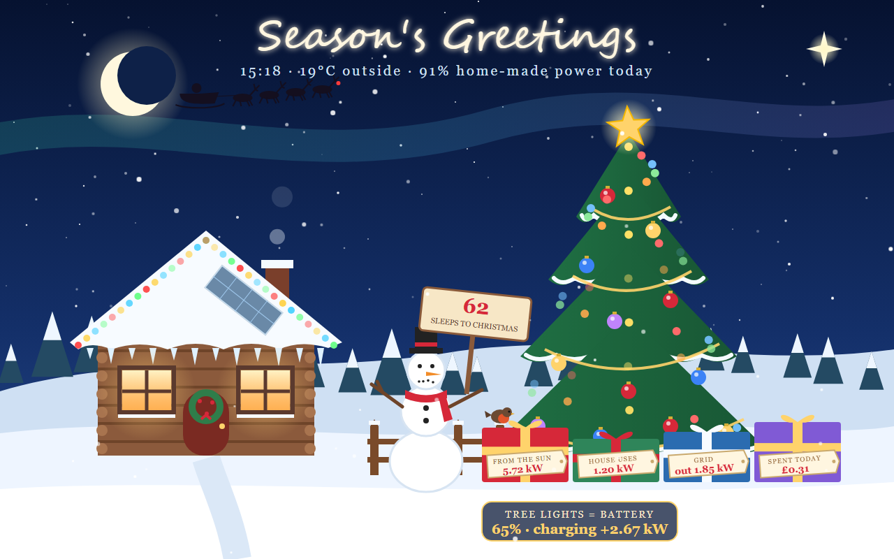

# Home Console

**A live, themeable dashboard for your home solar and battery system, built to give an old tablet a
second life.**

Home Console shows what your house is doing right now: solar coming in, battery charging or
discharging, the grid, and what the house is using. It does that through eight very different
full-screen themes, from a Star Trek LCARS panel to a cartoon cut-away of your house with the
pets wandering about. It is plain HTML and JavaScript with no build step, so it runs happily on a
2015 Amazon Fire 7 in a kiosk browser.

| | | |
|---|---|---|
|  **hud**: holographic HUD, energy streams that speed up with power |  **lcars**: Star Trek LCARS panels with a stardate |  **crt**: Fallout-style Pip-Boy STAT screen (HP = battery, CAPS = cost) |
|  **cyber**: rain-soaked neon city, katakana billboards |  **home**: cartoon cross-section of the house, with the pets |  **astrolabe**: today's solar and demand engraved on a 24-hour brass dial |
|  **halloween**: tombstone readouts, cauldron battery |  **xmas**: tree lights fill with battery charge | |

Tap the **top-right corner** of the screen to cycle themes. The choice is remembered per device.

## Features

- **Live**: Home Assistant's WebSocket API pushes changes instantly; no polling.
- **Pluggable data sources**: Home Assistant (with a ready-made Sigenergy entity preset), any
  JSON endpoint (for bridges to inverters, Node-RED, cloud APIs), or a built-in demo.
- **Runs on old hardware**: ES2017, no frameworks, no web fonts, no build. Tested on Fire OS 5.
- **Self-updating deployment**: an nginx + git-sync Docker stack; push to GitHub and the tablet
  shows the change within a minute.
- **Safe by default**: no secrets in served files; the token stays on the device.
- **Easy to theme**: one file per theme, a tiny API, and automatic smoke tests. See
  [CLAUDE.md](CLAUDE.md) for the full guide (it is written so Claude can build themes too).

## Quick start (demo, no setup)

```bash
git clone https://github.com/<you>/home-console.git
cd home-console
python3 -m http.server 8765        # or on Windows: powershell -File serve.ps1
```

Open <http://localhost:8765/site/index.html?demo=1>. Add `&theme=astrolabe` (or any theme name) to
jump straight to one.

## Connect it to Home Assistant

1. In Home Assistant, create a **long-lived access token**: your profile → Security → Long-lived
   access tokens. Ideally use a dedicated non-admin user for dashboards.
2. Create `site/config.local.js` (git-ignored) with your settings, using the same keys as
   [`site/config.js`](site/config.js):

   ```js
   window.HC_CONFIG_LOCAL = {
     url: 'http://homeassistant.local:8123',     // only needed when not using the nginx stack
     entities: {                                  // anything that differs from the Sigen defaults
       inTemp: 'sensor.lounge_temperature',
       iaqClass: 'sensor.lounge_air_quality',
     },
     scale: { pv: 6, grid: 6, load: 5, batt: 5 }, // full-scale kW, sized to your system
     site: 'MY-HOUSE',
   };
   ```

3. Open the page once with your token in the address: `…/site/index.html#token=YOUR_TOKEN`. It's
   saved on that device and removed from the address bar.

**Not on Sigenergy?** Map your inverter's entities in `entities`. The full list of keys, with the
Sigen defaults, is `SIGEN_ENTITIES` in [`site/sources/homeassistant.js`](site/sources/homeassistant.js).
If your battery power sensor is signed (+ charging), set `battCharging` and `battDischarging` to
`null`.

**No Home Assistant?** Set `source: 'json'` and `json: { url: '/readings.json' }`, and serve readings
JSON from anything you like. The fields are documented in [CLAUDE.md](CLAUDE.md#readings-what-a-source-provides).
A Sigen gateway, for example, speaks Modbus TCP, so a small bridge script can read it and serve
that JSON.

## Deploy (Docker / Portainer)

[`deploy/docker-compose.yml`](deploy/docker-compose.yml) runs **nginx** serving `site/` and a
**git sidecar** that pulls your repo every minute. nginx also proxies Home Assistant's WebSocket,
because Chrome blocks `http://` pages from connecting directly to other machines on your network.

1. Create a read-only **deploy key** (`ssh-keygen -t ed25519 -f deploy_key`) and add the `.pub` to
   your repo under Settings → Deploy keys.
2. In Portainer: **Stacks → Add stack**, paste the compose file and set these variables:

   | variable | value |
   |---|---|
   | `REPO` | `git@github.com:<you>/home-console.git` |
   | `DEPLOY_KEY_B64` | the private key, base64-encoded on one line (`base64 -w0 deploy_key`) |
   | `HA_UPSTREAM` | your Home Assistant, e.g. `http://192.168.1.50:8123` |
   | `PORT` | host port, default `8088` |
   | `CONSOLE_CONFIG` | optional JSON, the same as `HC_CONFIG_LOCAL` above, e.g. `{"entities":{"inTemp":"sensor.lounge_temperature"}}` |
   | `HA_TOKEN` | optional: serve the token so devices need no setup. Anyone on your network can read it, so use a non-admin HA user. |

3. Deploy, then open `http://<docker-host>:8088/`.

## The tablet

The reference setup is an old Amazon Fire 7 (5th gen, Fire OS 5) running **Fully Kiosk
Browser**. The last version for Android 5 is v1.59.2. In Fully, set:

- Start URL `http://<docker-host>:8088/`
- Keep Screen On and Start on Boot
- Fullscreen

Use Fully's screensaver, not "screen off", for night dimming on Fire OS 5. There's a
step-by-step write-up, including the pitfalls, in [docs/how-to.md](docs/how-to.md).

## Development

- `sh tests/run.sh` runs the test suite in headless Chrome or Edge; it also runs on every push
  via GitHub Actions. Or open `tests/index.html` in a browser.
- Adding a theme or a data source: read [CLAUDE.md](CLAUDE.md). It covers the architecture, the
  theme contract, the old-WebView rules and the gotchas.

## Licence

[MIT](LICENSE)
